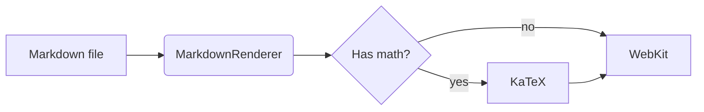

# MarkText 2 — Release notes

[](https://example.com/ci) 

MarkText 2 is a **native macOS** rewrite: a *simple viewer* that happens to edit. It opens in ***read mode***, renders ~~Electron~~ WebKit instantly, and keeps `⌘E` one keystroke away. Visit https://example.com/marktext or www.marktext.app for downloads, or read the [changelog](CHANGELOG.md) and the [roadmap](docs/roadmap.md#next-up).

> **Tip:** Press `⌘F` to find text in the preview.
>
> Blockquotes can hold *any* content, including lists:
>
> - first quoted item
> - second quoted item

## 🎉 What's new

### Reading experience

The preview uses the system font at 16/1.65, a 68ch measure and a quiet palette.
A soft break stays inside the paragraph,  
while a hard break (two trailing spaces) starts a new line.

- Live reload when the file changes on disk
- Outline sidebar with live highlight
  - Nested item with `inline code`
  - Another nested item
    1. Deeply nested ordered item
    2. And its sibling
- Appearance popover: theme, typeface, size and width

1. Open a file
2. Press `⌘E` to edit
3. Press `⌘P` to print

### Task list

- [x] Markdown to HTML engine
- [x] Outline sidebar
- [ ] Quick Look extension
- [ ] Export to PDF

### Tables

| Feature        | Shortcut | Status  | Notes                   |
| :------------- | :------: | ------: | ----------------------- |
| Toggle edit    | `⌘E`     | Done    | Read ↔ Split            |
| Source mode    | `⌘⌥E`    | Done    | Editor only             |
| Find           | `⌘F`     | Beta    | Uses **WebKit** find    |
| Export PDF     | `⌘⇧E`    | Planned | See [#export](#export)  |

## Code

Swift:

```swift
struct Greeter {
    let name: String
    func greet() -> String { "Hello, \(name)!" }
}
print(Greeter(name: "<MarkText>").greet())
```

JavaScript:

```js
const render = (md) => fetch("/render", { method: "POST", body: md }).then((r) => r.text());
console.log(1 < 2 && 3 > 2);
```

Python:

```python
def fib(n: int) -> int:
    return n if n < 2 else fib(n - 1) + fib(n - 2)
```

Shell:

```bash
swift test --parallel -c release
```

```
A fence without a language keeps its text as is: <b>not bold</b> & "quoted".
```

## Math

Inline math such as $E = mc^2$ sits in a sentence, as does $\alpha + \beta = \gamma$. Prices stay literal: it costs $5 and $10 in total. An escaped dollar \$x\$ is not math either.

Display math is centred:

$$
\int_{-\infty}^{\infty} e^{-x^2}\,dx = \sqrt{\pi}
$$

A single-line display $$a^2 + b^2 = c^2$$ works too, and a math fence also works:

```math
\sum_{k=1}^{n} k = \frac{n(n+1)}{2}
```

Code is never math: `$not math$` and

```
echo "$HOME and $PATH"
```

## Diagrams



## Images

A local image: 

A remote badge: 

## Raw HTML

<div class="callout" style="border-left: 4px solid orange; padding: 4px 12px;">
  <strong>Heads up:</strong> raw HTML passes through to the sanitizer.
</div>

Inline <kbd>⌘</kbd> + <kbd>E</kbd> keys and a <span class="chip">chip</span>.

<details>
<summary>Click to expand</summary>

Hidden *content* with markdown.

</details>

---

## Export

Final paragraph with a footnote-like reference, an [autolink](https://example.com/docs?a=1&b=2) and <https://example.com/autolink>.

## Export

Duplicate headings get numbered slugs.
