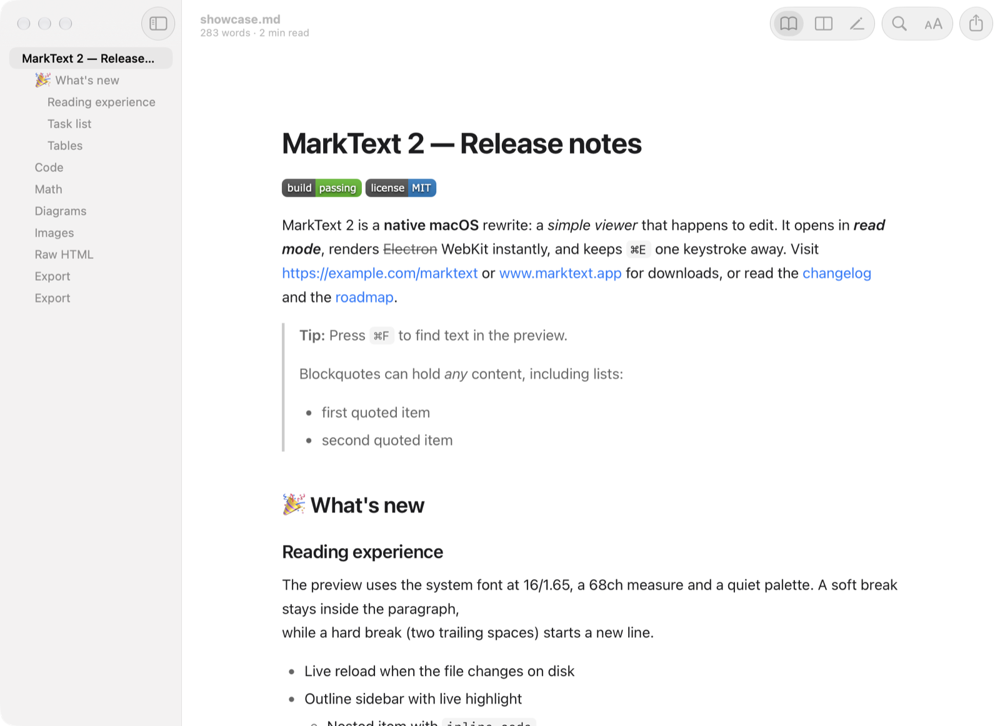
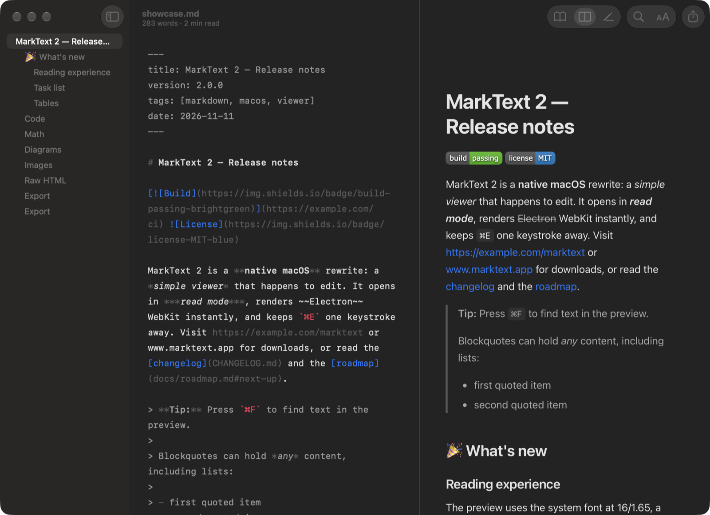
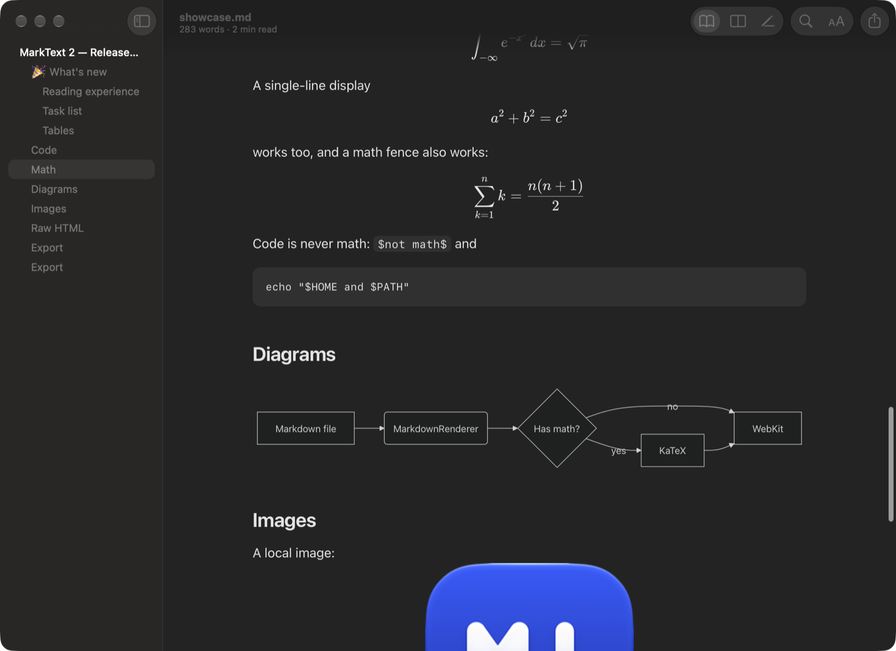
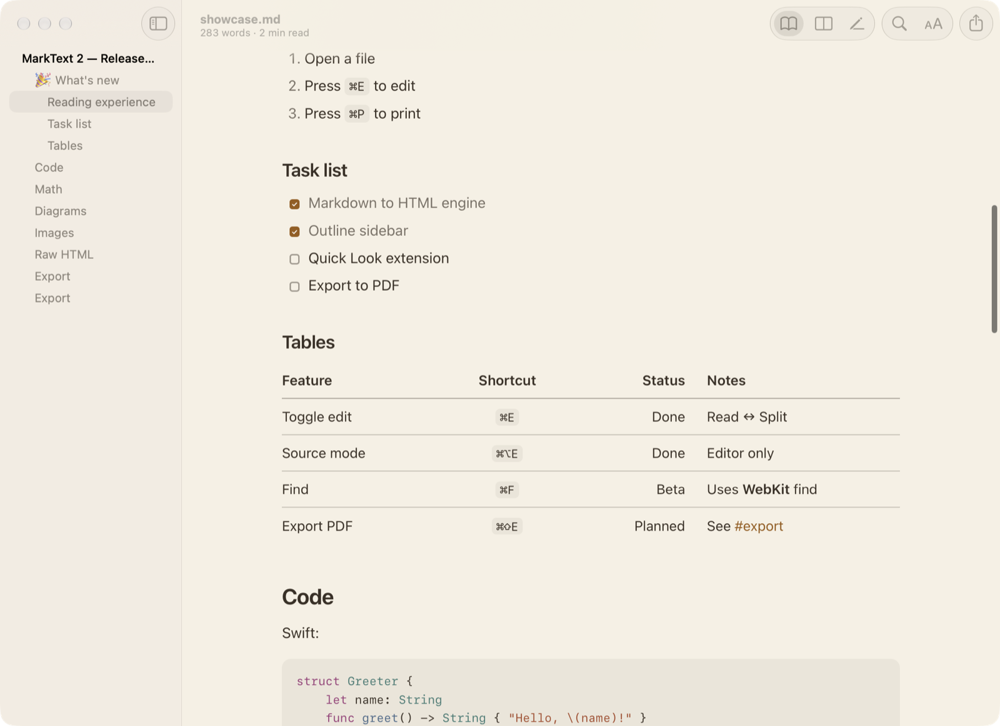
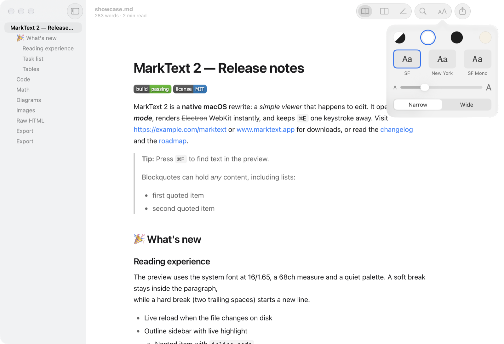

<p align="center">
  
</p>

<h1 align="center">MarkText 2</h1>

<p align="center">
  A native macOS markdown viewer that can also edit.<br>
  Swift, Liquid Glass, Apple Silicon. A 4.6 MB download.
</p>

<p align="center">
  <a href="https://github.com/greenerycomplexity/marktext/releases/latest"><b>Download for macOS</b></a>
  · macOS 26 or later · Apple Silicon
</p>

<p align="center">
  
</p>

> [!NOTE]
> This is an **unofficial** fork of [MarkText](https://github.com/marktext/marktext). It is a clean-room rewrite in Swift, not an update of the Electron app, and it is not affiliated with the MarkText maintainers. The original's history is on the [`develop`](https://github.com/greenerycomplexity/marktext/tree/develop) branch.

## Why, and how it differs from MarkText

[MarkText](https://github.com/marktext/marktext) is actively maintained again, with new releases since late 2026, and it's the right choice if you want a full WYSIWYG editor on Windows, Linux and Mac.

MarkText 2 started from the 0.17.1 Homebrew cask (2022) and went a different way: a Mac-only app that reads markdown first, edits it in a plain-text editor beside the preview, and uses only the system's own frameworks.

| | MarkText 0.23 | MarkText 2 |
|---|---|---|
| Platforms | macOS 13+, Windows, Linux | macOS 26+, Apple Silicon only |
| Stack | Electron 45 | Swift 6, AppKit + SwiftUI, WebKit |
| macOS download | 150 MB | 4.6 MB (13 MB installed) |
| Editing | WYSIWYG, tabs, file tree, rich tooling | Reading view + source editor, one window per document |
| Mac integration | Cross-platform UI | Liquid Glass toolbar, `NSDocument` autosave and versions, Quick Look extension, system find and spellcheck |

## Features

- **Read first.** Documents open in a clean reading view. `⌘E` puts the editor beside it, and `⌥⌘E` gives you the editor alone.
- **Outline sidebar** that follows along as you scroll. Click a heading to jump to it.
- **GitHub-flavored markdown:** tables, task lists, strikethrough, autolinks, front matter.
- **Math** with KaTeX (`$inline$`, `$$display$$`, and ```` ```math ```` fences). **Diagrams** with mermaid. **Syntax highlighting** for code.
- **Images** from relative paths next to the file, and remote images such as README badges.
- **Live reload:** when another app (an editor, `git pull`, a script) changes the file, the view updates in place. Files you haven't edited are never rewritten, and the encoding, BOM and line endings are preserved on save.
- **Themes:** Auto, Light, Dark and Sepia. **Typefaces:** SF, New York and SF Mono. Text size (`⌘+` / `⌘−`) and line width.
- **Find** (`⌘F`), **Print** (`⌘P`), **Export to PDF or a self-contained HTML file**.
- **Quick Look:** press space on a `.md` file in Finder to see it rendered.

<p align="center">
  
</p>

<table>
  <tr>
    <td></td>
    <td></td>
  </tr>
  <tr>
    <td align="center">Math and diagrams</td>
    <td align="center">Sepia theme</td>
  </tr>
</table>

<p align="center">
  
</p>

### Keyboard

| Action | Shortcut |
|---|---|
| Read / Split / Edit | `⌘1` / `⌘2` / `⌘3` |
| Toggle Read ↔ Split | `⌘E` |
| Editor only | `⌥⌘E` |
| Find, next, previous | `⌘F`, `⌘G`, `⇧⌘G` |
| Text size | `⌘+`, `⌘−`, `⌘0` |
| Show or hide the outline | `⌃⌘S` |
| Print / Export PDF | `⌘P` / `⌥⌘P` |
| Settings | `⌘,` |

### What's not here (on purpose)

There are no tabs, file tree, image uploaders, command palette or custom spellchecker. Each document opens in its own window. macOS spellcheck is available in the editor from Edit › Spelling.

## Install

1. Download `MarkText-2.0.0-arm64.dmg` from [Releases](https://github.com/greenerycomplexity/marktext/releases/latest).
2. Open the DMG and drag **MarkText** to **Applications**.
3. Right-click a `.md` file › Open With › MarkText. To make it the default, use Get Info › Open with › Change All.

The app is signed with a Developer ID and notarized by Apple, so it opens like any other Mac app.

Check the download against the `.sha256` file published with each release: `shasum -a 256 MarkText-2.0.0-arm64.dmg`.

## Build from source

Requirements: Xcode 26 or later, [XcodeGen](https://github.com/yonaskolb/XcodeGen) (`brew install xcodegen`), and an Apple Silicon Mac.

```bash
git clone -b native https://github.com/greenerycomplexity/marktext.git
cd marktext/MarkText
./Scripts/generate.sh
xcodebuild -project MarkText.xcodeproj -scheme MarkText -configuration Release -derivedDataPath build/DerivedData build
open build/DerivedData/Build/Products/Release/MarkText.app
```

Builds are ad-hoc signed by default. To sign with your own identity, create `MarkText/Config/Signing.local.xcconfig` (it is gitignored):

```
CODE_SIGN_IDENTITY = Apple Development
DEVELOPMENT_TEAM = ABCDE12345
```

Tests:

```bash
cd MarkText/Packages/MarkTextKit && swift test -c release --parallel
```

## How it works

```
MarkText/
  Packages/MarkTextKit/   Markdown → HTML engine, editor tokenizer, text codec, web assets (shared by the app and Quick Look)
  Sources/MarkText/       The app: NSDocument, windows and toolbar, SwiftUI views, editor, preview, export
  Sources/MarkTextQuickLook/  Quick Look preview extension
  Scripts/                Project generation, release packaging, background test harnesses
docs/                     Architecture plan and UX spec
```

- **Parsing** uses [cmark-gfm](https://github.com/swiftlang/swift-cmark) through its C API. Math is protected from the markdown parser in a pre-pass, and every block carries its source line so the editor and preview scroll together.
- **The preview** is a `WKWebView` that loads a bundled template once. Edits only replace the blocks that changed, and KaTeX and mermaid output is cached, so typing in a long document stays cheap. Raw HTML is sanitized with DOMPurify under a strict Content-Security-Policy, and links to apps or scripts are revealed in Finder instead of run.
- **The editor** is a TextKit 2 `NSTextView` with incremental markdown highlighting and list continuation.
- **Documents** are standard `NSDocument`s: autosave, versions, revert and recent files all behave as they do in other Mac apps.
- **Network:** the app makes no network requests of its own. The only network access is loading remote images that a document references.

The design and architecture decisions are in [`docs/PLAN.md`](docs/PLAN.md) and [`docs/DESIGN.md`](docs/DESIGN.md).

## Credits and licenses

MarkText 2 is MIT licensed (see [LICENSE](LICENSE)), the same as the original MarkText by Luo Ran and the MarkText contributors. It bundles:

- [cmark-gfm](https://github.com/swiftlang/swift-cmark) (BSD-2-Clause)
- [KaTeX](https://katex.org) 0.16 (MIT; fonts OFL-1.1)
- [mermaid](https://mermaid.js.org) 11 (MIT)
- [highlight.js](https://highlightjs.org) 11 (BSD-3-Clause)
- [DOMPurify](https://github.com/cure53/DOMPurify) 3 (MPL-2.0 or Apache-2.0)

The pinned versions and checksums are in [`vendor/VERSIONS.md`](MarkText/Packages/MarkTextKit/Sources/MarkTextKit/Resources/web/vendor/VERSIONS.md), and the full license texts are in [`vendor/LICENSES.txt`](MarkText/Packages/MarkTextKit/Sources/MarkTextKit/Resources/web/vendor/LICENSES.txt).
